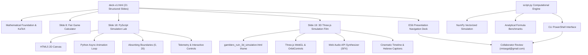

# Product Requirements Document (PRD)

# Simple Random Walk & The Gambler's Ruin Problem
### Rigorous Probability Theory Meets Interactive Visual Storytelling

---

| **Document Version** | 1.2.0-PROD |
| **Status** | Approved / Aligned with `deck-v1.html` Production Baseline (21 Slides) |
| **Project Lead & Author** | Elite Software Consultant & Data Science Specialist |
| **Collaborator / Reviewer** | `rmisegal@gmail.com` |
| **Target Audience** | University Mathematics, Statistics & Computer Science Faculty and Students |
| **Development Environment** | Google Antigravity CLI (Gemini) via Windows PowerShell |
| **Release Target** | Academic Year 2026/2027 – Stochastic Processes & Probability Theory |

---

## 1. Executive Summary & Vision

### 1.1 Strategic Vision & Academic Context
Probability theory and stochastic processes often suffer from a pedagogical disconnect in university education: students can manipulate abstract algebraic difference equations and Markov chain transition matrices, yet struggle to develop an intuitive, geometric, and dynamic grasp of stochastic trajectories, boundary collisions, recurrence properties, and the Law of Large Numbers.

This project, titled **"Simple Random Walk & The Gambler's Ruin Problem"**, bridges rigorous analytical probability theory with intuitive, highly polished, interactive visual storytelling. Delivered as a standalone, zero-build academic web deck ([`deck-v1.html`](file:///C:/Users/STD577L/Downloads/deck-v1.html)), the platform integrates an exhaustive 21-slide analytical presentation, embedded interactive calculators, an in-browser Python simulation laboratory powered by **PyScript**, an interactive 3D stochastic film simulation powered by **Three.js** ([`gamblers_ruin_3d_simulation.html`](file:///C:/Users/STD577L/Downloads/gamblers_ruin_3d_simulation.html)), and an industrial-grade Python computational backend ([`script.py`](file:///C:/Users/STD577L/Downloads/script.py)) for theoretical verification and Monte Carlo benchmarking.

```
       +-------------------------------------------------------+
       |                  PEDAGOGICAL TRIAD                    |
       +-------------------------------------------------------+
                                  |
         +------------------------+------------------------+
         |                                                 |
         v                                                 v
+-------------------------------+               +-------------------------------+
|     ANALYTICAL RIGOR          |               |    DYNAMIC VISUALIZATION      |
|  - Difference Equations       |<=============>|  - 21-Slide Interactive Deck  |
|  - Martingales & OST          |               |  - Slide 8 Analytical Calc    |
|  - Absorbing Markov Chains    |               |  - Slide 18 PyScript Lab      |
|                               |               |  - Slide 19 3D Simulation Film|
+-------------------------------+               +-------------------------------+
                                 \             /
                                  \           /
                                   v         v
                        +-------------------------------+
                        |    COMPUTATIONAL BACKEND      |
                        |  - Vectorized Monte Carlo     |
                        |  - Confidence Intervals (3σ)  |
                        |  - Headless CLI (script.py)   |
                        +-------------------------------+
```

### 1.2 Core Educational Philosophy
1. **From Symbol to Motion**: Mathematical abstractions (such as $P(\text{Ruin}) = 1 - k/N$) are immediately grounded through live interactive path generation where each discrete step $X_{n+1} = X_n + \xi_n$ is visualized in real time against absorbing boundary barriers.
2. **Accessible Academic Typography**: Designed with an editorial "Warm Cream" aesthetic, Inter and JetBrains Mono typography, and KaTeX mathematical typesetting, ensuring that lecture presentations maintain publication-grade clarity across large lecture hall projectors and student laptops.
3. **Interactive Experimentation**: Complex concepts like the "Fair Game Paradox", exponential odds collapse against house edge, and stopping times are directly demonstrable via interactive sliders without switching applications.
4. **Reproducibility & Open Science**: Every analytical claim presented in the deck is backed by a reproducible Python computational backend (`script.py`) with verifiable Monte Carlo convergence metrics conforming to the Law of Large Numbers ($\mathcal{O}(1/\sqrt{M})$).

### 1.3 Target Personas
* **Professor / Lecturer**: Needs an interactive, presentation-ready web deck capable of being driven from a podium via keyboard shortcuts (`Space`, `Arrows`, `Home`, `Fullscreen`), equipped with embedded live simulations to instantly answer "what-if" questions from students (e.g., modulating step bias $p$ from $0.50$ to $0.48$).
* **Undergraduate / Graduate Student**: Seeks to verify theoretical homework solutions against visual stochastic paths, observing how boundary absorption occurs in finite expected time and why fair coin tosses lead to certain ruin against deep-pocketed adversaries.
* **Academic Reviewer / Evaluator**: Requires transparent version control, reproducible prompt tracking (`prompts/`), clean software engineering practices, collaborator accessibility (`rmisegal@gmail.com`), and verifiable numerical convergence.

### 1.4 Success Metrics (KPIs)
* **Mathematical Accuracy**: Zero divergence between analytical formulas and computational implementations ($|P_{\text{empirical}} - P_{\text{analytical}}| < 3 \times \text{SE}$ at 99.7% confidence).
* **Zero-Server Portability**: Complete standalone execution in standard modern web browsers via self-contained HTML5/CSS3/ES6 and PyScript WebAssembly with zero build steps or local server requirements.
* **Simulation Responsiveness**: Fluid real-time 60 FPS canvas rendering with dynamic HiDPI/Retina scaling.
* **Slide Transition Latency**: Sub-50ms slide transition latency with instant modal thumbnail drawer indexing.

---

## 2. Mathematical Foundations & Theoretical Scope

The product strictly encodes and demonstrates the core theorems of discrete-time simple random walks and classical Gambler's Ruin.

### 2.1 1D Simple Random Walk Formalism
Let $(\Omega, \mathcal{F}, P)$ be a probability space. Let $\{\xi_n\}_{n=1}^\infty$ be a sequence of independent and identically distributed (i.i.d.) discrete random variables with distribution:
$$P(\xi_n = +1) = p, \quad P(\xi_n = -1) = q = 1 - p, \quad \text{where } p \in (0, 1)$$

The simple random walk $\{S_n\}_{n \ge 0}$ starting at $S_0 = k \in \mathbb{Z}$ is defined by:
$$S_n = k + \sum_{i=1}^n \xi_i, \quad n \ge 1$$

* **Markov Property**: $P(S_{n+1} = s \mid S_n = s_n, \dots, S_0 = s_0) = P(S_{n+1} = s \mid S_n = s_n)$.
* **Expectation & Drift**: $E[S_n] = k + n(p - q)$. For symmetric walk ($p = q = 1/2$), drift vanishes: $E[S_n] = k$.
* **Variance**: $\text{Var}(S_n) = 4npq$. For symmetric walk, $\text{Var}(S_n) = n$.

### 2.2 Gambler's Ruin Problem & Boundary Conditions
Let the state space be restricted to the finite lattice:
$$\mathcal{S} = \{0, 1, 2, \dots, N\}$$
where:
* **State $0$** represents Gambler's Ruin (bankruptcy).
* **State $N$** represents House Ruin / Target Fortune (victory).
* Both state $0$ and state $N$ are **absorbing barriers**:
  $$P(S_{n+1} = 0 \mid S_n = 0) = 1, \quad P(S_{n+1} = N \mid S_n = N) = 1$$
* Interior states $1 \le k \le N - 1$ are **transient**.

Let $T = \inf \{n \ge 0 : S_n = 0 \text{ or } S_n = N\}$ denote the absorption stopping time. Almost-sure absorption guarantees:
$$P(T < \infty) = 1, \quad P(S_T = 0) + P(S_T = N) = 1$$

### 2.3 Closed-Form Analytical Ruin Probabilities
Let $R_k = P(S_T = 0 \mid S_0 = k)$ denote the probability of ruin starting from capital $k$. Using First-Step Analysis and the Law of Total Probability:
$$R_k = p R_{k+1} + q R_{k-1}, \quad \text{for } 1 \le k \le N - 1$$
with boundary conditions:
$$R_0 = 1, \quad R_N = 0$$

#### Analytical Solution:
* **Symmetric Case ($p = q = 1/2$)**:
  The characteristic recurrence yields linear roots:
  $$R_k = 1 - \frac{k}{N}, \quad P(\text{Win}) = \frac{k}{N}$$
  *(Proportional Equity Principle: in a fair contest, victory odds reflect initial capital share).*
* **Asymmetric Case ($p \neq q$)**:
  Let the odds ratio be $\lambda = \frac{q}{p}$. The general solution satisfies:
  $$R_k = \frac{\lambda^k - \lambda^N}{1 - \lambda^N}$$
  * For unfavorable drift ($p < 0.5 \implies \lambda > 1$), ruin probability approaches $1$ exponentially as $N \to \infty$.
  * For favorable drift ($p > 0.5 \implies \lambda < 1$), the ruin probability remains strictly bounded: $\lim_{N \to \infty} R_k = \lambda^k < 1$.

### 2.4 Expected Duration of Play (Stopping Time $E[T]$)
Let $D_k = E[T \mid S_0 = k]$ be the expected number of steps until absorption:
$$D_k = 1 + p D_{k+1} + q D_{k-1}, \quad \text{for } 1 \le k \le N - 1$$
with boundary conditions $D_0 = 0$ and $D_N = 0$.

#### Closed-Form Expected Duration:
* **Symmetric Case ($p = q = 1/2$)**:
  $$D_k = k(N - k)$$
  *(Attains maximum parabolic duration $D_{N/2} = N^2/4$ when started at mid-bankroll. Exhibiting a quadratic time penalty).*
* **Asymmetric Case ($p \neq q$)**:
  $$D_k = \frac{1}{q - p} \left[ k - N \cdot \frac{1 - \lambda^k}{1 - \lambda^N} \right]$$
  *(Strong bias causes the drift term to dominate, sharply contracting expected game duration).*

### 2.5 Martingale & Optional Stopping Theorem (OST) Formulation
For advanced mathematical elegance, difference equations can be bypassed using Doob's Optional Stopping Theorem:
* **Linear Martingale**: Under $p = 1/2$, $M_n = S_n$ is a martingale. Since $T$ is almost surely finite with bounded increments:
  $$E[S_T] = S_0 = k \implies 0 \cdot P(S_T = 0) + N \cdot P(S_T = N) = k \implies P(S_T = N) = \frac{k}{N}$$
* **Quadratic Martingale**: The process $M_n = S_n^2 - n$ is a martingale under $p = 1/2$:
  $$E[S_T^2 - T] = S_0^2 = k^2 \implies E[T] = E[S_T^2] - k^2 = N^2\left(\frac{k}{N}\right) - k^2 = k(N - k)$$
* **Exponential Martingale**: Under $p \neq 1/2$, Wald's exponential martingale $M_n = \lambda^{S_n} = (q/p)^{S_n}$ satisfies $E[\lambda^{S_T}] = \lambda^k$, directly yielding the asymmetric ruin formula in one algebraic step.

### 2.6 Pólya's Recurrence Theorem (Lattice Walks $\mathbb{Z}^d$)
The product contextualizes 1D absorbing walks within Pólya's classic 1921 theorem for simple symmetric random walks on lattices $\mathbb{Z}^d$:
* **$\mathbb{Z}^1$ (1D)**: Recurrent ($u_{2n} \sim 1/\sqrt{\pi n}$, $\sum u_{2n} = \infty$, return probability = $1$).
* **$\mathbb{Z}^2$ (2D)**: Recurrent ($u_{2n} \sim 1/(\pi n)$, logarithmic divergence, return probability = $1$).
* **$\mathbb{Z}^3$ (3D)**: **Transient** ($u_{2n} \sim 1/(\pi n)^{3/2}$, summable series, return probability $\approx 0.3405373$).
* *Pedagogical Maxim*: "A drunk man will find his way home, but a drunk bird may get lost forever."

---

## 3. Product Specifications & Architecture

### 3.1 Deliverable 1: Interactive Academic Web Deck (`deck-v1.html`)
* **Primary Implementation**: [`C:\Users\STD577L\Downloads\deck-v1.html`](file:///C:/Users/STD577L/Downloads/deck-v1.html).
* **Slide Count**: Exactly **21 structured slides** (numbered 1 through 21).
* **Language & Layout**:
  * Root HTML attribute: `<html lang="en" dir="ltr">`.
  * Fully responsive container (`max-width: 1180px`, `min-height: 560px`), with mobile-adaptive layouts down to 768px.
  * Modern typographic stack: Google Fonts `Inter` (sans-serif) for body and headings; `JetBrains Mono` for mathematical parameters, code, and numerical statistics.
* **Mathematical Typography**: KaTeX `v0.16.9` auto-rendered across all slides with delimiters `$$...$$` and `$...$`.
* **Visual Palette**: Warm Academic Editorial palette with soft cream base backgrounds (`#FAF8F5`, `#F4F0E8`, `#FFFFFF`, `#FDFBF7`), subtle warm borders, and 7 soft pastel semantic categories (Blue, Sage, Lavender, Rose, Amber, Coral, Cyan).

#### Complete 21-Slide Structural Blueprint

| Slide # | Slide Badge & Category | Title & Subtitle | Key Elements & Interactive Features |
| :---: | :--- | :--- | :--- |
| **01** | `Academic Lecture Series \| Stochastic Processes` | **Simple Random Walk & The Gambler's Ruin Problem**<br>*Bridging Rigorous Probability Theory with Interactive Visual Storytelling* | Executive Overview card, Pedagogical Architecture triad card, Fundamental Inquiry callout ("Can an agent with finite capital prevail against an infinite house?"). |
| **02** | `02 \| Motivation & Context` | **From Microscopic Fluctuation to Universal Law**<br>*Why a simple coin-toss sequence dictates market crashes and genetic drift* | 3-card grid: Quantitative Finance (Bachelier/Black-Scholes), Population Genetics (Wright-Fisher allele fixation), Statistical Physics (Brownian motion/Langevin); Counter-intuitive reality callout. |
| **03** | `03 \| Mathematical Formalism` | **The 1D Simple Random Walk**<br>*Axiomatic construction on a probability space $(\Omega, \mathcal{F}, P)$* | Discrete step distribution $\xi_i \in \{-1, +1\}$, moments and drift dynamics card, expectation formula, variance formula, symmetric vanishing drift callout. |
| **04** | `04 \| State Dynamics` | **The Markov Property & State Space**<br>*Memorylessness across discrete time steps* | Formal memorylessness definition card, tridiagonal transition probability matrix $P$, absorbing boundary states card, state transition diagram. |
| **05** | `05 \| Problem Formulation` | **The Gambler's Ruin Formulation**<br>*Finite bankrolls, unit wagers, and terminal absorption* | Game rules & conservation of capital card ($k + (N-k) = N$), stopping time $T = \inf\{n: S_n \in \{0, N\}\}$ card, almost-sure absorption theorem callout. |
| **06** | `06 \| Boundary Analysis` | **Classification of States & Boundaries**<br>*Absorbing states versus transient interior states* | Interior transient states ($1 \le k \le N-1$) card, boundary absorbing states ($0, N$) card, dichotomy of fates callout ($P(\text{Ruin}) + P(\text{Win}) = 1$). |
| **07** | `07 \| Analytical Derivation` | **First-Step Analysis & Difference Equations**<br>*Decomposition via the Law of Total Probability* | Recurrence relation $R_k = p R_{k+1} + q R_{k-1}$ card, boundary conditions $R_0 = 1, R_N = 0$ card, equivalent second-order difference equation card. |
| **08** | `08 \| Closed-Form Solution` | **The Fair Game: Symmetric Walk ($p = 1/2$)**<br>*A linear profile proportional to initial capital ratio* | Theorem callout ($R_k = 1 - k/N$), Proportional Equity Principle card, plus **Interactive Fair Game Calculator** with real-time sliders for $k \in [1, 99]$ and $N \in [20, 200]$ calculating live percentages. |
| **09** | `09 \| Closed-Form Solution` | **The Biased Game: Asymmetric Walk ($p \neq q$)**<br>*Exponential decay driven by geometric odds ratio* | Geometric series summation card with odds ratio $\lambda = q/p$, general closed-form formula card, unfavorable drift callout ($p < 0.5$), favorable drift callout ($p > 0.5$). |
| **10** | `10 \| Empirical Casino Analysis` | **The House Advantage: European Roulette**<br>*How a tiny 1.35% house edge eliminates long-run player survival* | Full empirical comparative table for $k=\$10, \$50, \$100$ vs $N=\$20, \$100, \$200, \$1,000$ comparing Fair Game ($p=0.5$) vs Roulette ($p=18/37$), showing exponential collapse to $0.44\%$ and $0.0005\%$. |
| **11** | `11 \| Stopping Time Dynamics` | **Expected Duration of Play: Fair Game**<br>*Analytical analysis of absorption stopping time $E[T \mid S_0 = k]$* | Recurrence relation card $D_k = 1 + \frac{1}{2}D_{k+1} + \frac{1}{2}D_{k-1}$, parabolic solution card $D_k = k(N-k)$, quadratic time penalty callout ($N=100, k=50 \implies 2,500$ steps). |
| **12** | `12 \| Stopping Time Dynamics` | **Expected Duration: Asymmetric Formulation**<br>*How bias sharply contracts play duration* | General closed-form solution card ($p \neq q$), asymmetry contraction effect card, unbounded target limit card ($N \to \infty \implies D_k \to \frac{k}{q-p}$). |
| **13** | `13 \| Advanced Perspective` | **Martingales & Doob's Optional Stopping**<br>*Bypassing difference equations through conservation of expected value* | Martingale process definition card $E[M_{n+1} \mid \mathcal{F}_n] = M_n$, Doob's Optional Stopping Theorem (OST) card, one-line proof of symmetric ruin probability card. |
| **14** | `14 \| Advanced Perspective` | **Quadratic & Exponential Martingales**<br>*Deriving duration and asymmetric solutions through invariant transforms* | Quadratic martingale card ($M_n = S_n^2 - n \implies E[T] = k(N-k)$), Wald's exponential martingale card ($M_n = (q/p)^{S_n} \implies$ asymmetric formula). |
| **15** | `15 \| Computational Backend` | **Vectorized Monte Carlo Architecture**<br>*Simulating hundreds of thousands of parallel paths in Python (`script.py`)* | Vectorized step execution principles card, unbiased ruin estimator $\hat{R}_k$, standard error $\text{SE}$, confidence bounds, Python implementation schema card ($>50,000$ trajectories in $<1.5\text{s}$). |
| **16** | `16 \| Empirical Verification` | **Validation: Theory vs. Monte Carlo**<br>*Statistical convergence adhering to the Law of Large Numbers* | Empirical benchmark matrix table ($N=20, M=100,000$ trials) comparing theoretical vs empirical ruin rates across $k \in \{5, 10, 15\}$ (absolute error $< 0.0008$), CLT convergence asymptotics card ($\mathcal{O}(1/\sqrt{M})$). |
| **17** | `17 \| Higher Dimensions` | **Random Walks in $\mathbb{Z}^d$ & Pólya's Theorem**<br>*"A drunk man will find his way home, but a drunk bird may get lost forever"* | 3-card grid: $\mathbb{Z}^1$ (recurrent null, $P=1$), $\mathbb{Z}^2$ (recurrent null, $P=1$), $\mathbb{Z}^3$ (transient, $P \approx 0.3405$); Pólya's 1921 Recurrence Criterion callout. |
| **18** | `18 \| Interactive Visual Lab` | **Live Stochastic Simulation Laboratory**<br>*Real-time path generation with absorbing boundaries ($0$ and $N=20$)* | **In-Browser Python Simulation Engine via PyScript**: HTML5 2D `<canvas id="walkCanvas">`, real-time random walk trajectory, glowing particle head, green target boundary ($N=20$), red ruin boundary ($0$), midline ($k=10$), live controls (Start/Pause/Resume/Restart, Reset, Probability slider, step counter, position, dynamic status). |
| **19** | `19 \| 3D Visual Simulation` | **3D Stochastic Simulation & Animated Film**<br>*Three-dimensional interactive visualization of gambler's ruin dynamics with playback controls* | **3D Simulation Film Engine via Three.js**: Embedded 3D scene (`gamblers_ruin_3d_simulation.html`) in a responsive 540px container (`#sim-3d-iframe`, `#0d1117` background), circular casino table, emerald felt, 11-step lattice track, dynamic 3D chip stacks (blue gambler, purple house), animated gold pawn with parabolic jump physics and tip-over ruin event, spinning 3D coin, Web Audio API procedural sound synthesizer (coin flip, step tones, ruin descent), scripted 7-cue cinematic timeline with synchronized Hebrew pedagogical captions, and interactive controls (`נגן סרטון` / `השהה`, `איפוס`, audio mute toggle, OrbitControls). |
| **20** | `20 \| Real-World Applications` | **Applications in Data Science & Machine Learning**<br>*Modern algorithms resting upon random walk foundations* | 3-card grid: MCMC & Metropolis-Hastings sampling in Bayesian stats, Merton corporate credit risk structural models, Drift-Diffusion Models (DDM) in cognitive science; Google's original PageRank algorithm callout. |
| **21** | `21 \| Summary & Conclusion` | **Summary, References & Project Resources**<br>*Synthesis of theoretical principles and computational tools* | Theoretical synthesis card, academic literature references card (Feller, Ross, Grimmett & Stirzaker, Williams), CLI execution and collaborator access card (`python script.py --trials 50000 --capital 10 --target 30`, `rmisegal@gmail.com`). |

---

### 3.2 Deliverable 2: Slide 18 Python In-Browser Simulation Engine (PyScript)
Slide 18 features a production-grade, in-browser stochastic laboratory executing client-side Python via **PyScript**:

* **Runtime Stack**:
  * PyScript core distribution (`https://pyscript.net/releases/2024.8.1/core.js` and `core.css`).
  * WebAssembly Python execution environment (`<script type="py">` via Pyodide / MicroPython).
* **Canvas Visualization Architecture**:
  * HTML5 2D `<canvas id="walkCanvas">` with Retina / HiDPI hardware scaling (`window.devicePixelRatio`).
  * Background fill: Soft Cream (`#F8F5EE`).
  * Upper Absorbing Boundary ($N = 20$): Emerald green dashed line (`rgba(5, 150, 105, 0.7)`, dash `[6, 4]`) with monospace annotation `"Target (N = 20) Win"`.
  * Lower Absorbing Boundary ($0$): Crimson red dashed line (`rgba(225, 29, 72, 0.7)`) with monospace annotation `"Ruin (0) Loss"`.
  * Midline Starting Horizon ($k = 10$): Muted slate dashed line (`rgba(203, 213, 225, 0.8)`, dash `[2, 4]`).
  * Trajectory Path: Solid royal blue stroke (`#2563eb`, width `2.5px`).
  * Active Particle Head: Glowing royal particle (`#1d4ed8`, radius `5px`, shadow blur `8px`, shadow color `rgba(37, 99, 235, 0.35)`).
* **Python Simulation State & Async Event Loop**:
  ```python
  sim_pos = 10
  SIM_MAX_N = 20
  sim_steps = 0
  sim_path = [10]
  sim_p = 0.50
  sim_running = False
  sim_loop_id = 0
  ```
  * Stepping logic: `step = 1 if random.random() < sim_p else -1`.
  * Async execution: Non-blocking asynchronous task loop `sim_loop` driven by `await asyncio.sleep(0.07)` (~70ms frame cadence).
  * Concurrency guard: Monotonically increasing `sim_loop_id` preventing concurrent race conditions upon rapid pause/resume clicks.
* **Interactive Control Suite & DOM Synchronization**:
  * **Start / Pause / Resume / Restart Button** (`#start-walk-btn`):
    * Initial: `▶ Start Simulation`
    * Running: `⏸ Pause` (Status: `Running...` in cyan)
    * Paused: `▶ Resume` (Status: `Paused` in amber)
    * Terminal Absorption: `▶ Restart` (Status: `Target Reached!` in emerald or `Ruin Absorbed!` in rose)
  * **Reset Button** (`.sim-btn.danger`):
    * Immediately halts execution, resets position to $10$, step counter to $0$, path to `[10]`, status to `Ready`, and redraws initial baseline.
  * **Step Probability Slider** (`#sim-p`):
    * Range: `0.10` to `0.90` (step `0.02`, default `0.50`).
    * Real-time readout dynamically synchronized to `#sim-p-display`.
  * **Live Telemetry Pills**:
    * Steps counter: `#step-count`
    * Position counter: `#current-pos` ($S_n$)
    * Simulation Status: `#sim-status`
* **Lifecycle & Viewport Observers**:
  * `MutationObserver` listening to class changes on `.slide[data-slide="18"]` to trigger canvas initialization the moment Slide 18 becomes active.
  * `resize` event listener ensuring dynamic canvas scaling when the browser window is resized.

---

### 3.3 Deliverable 3: Slide 8 Interactive Fair Game Calculator
Embedded in Slide 8 is a dedicated client-side calculator illustrating the Proportional Equity Principle:
* **Sliders**:
  * Initial Capital $k \in [1, 99]$ (`#sym-k`, default `20`).
  * Target Bankroll $N \in [20, 200]$ (`#sym-n`, default `100`).
* **Constraints**: Automatic boundary enforcement ensuring $k < N$ (auto-clamps $k = N - 1$ if exceeded).
* **Live Calculations**:
  $$P(\text{Ruin}) = \left(1 - \frac{k}{N}\right) \times 100\%, \quad P(\text{Win}) = \left(\frac{k}{N}\right) \times 100\%$$
* **Output Display**: Styled badges highlighting Ruin Probability in rose (`#sym-ruin-res`) and Win Probability in sage (`#sym-win-res`).

---

### 3.4 Deliverable 4: Slide 19 3D Stochastic Simulation & Animated Film (`gamblers_ruin_3d_simulation.html`)
Slide 19 introduces an interactive, three-dimensional cinematic stochastic film simulation embedded directly into the presentation stage via an `iframe`, providing a tangible spatial representation of the Gambler's Ruin problem:

* **Runtime Stack & Dependencies**:
  * **Three.js** (`r128` via cdnjs): 3D scene graphing, WebGL rendering, mesh shaders, dynamic shadows, and camera projection.
  * **OrbitControls** (`three@0.128.0/examples/js/controls/OrbitControls.js`): Free user camera manipulation with inertial damping (`dampingFactor = 0.05`) and polar angle clamping ($\le \pi/2 - 0.05$) to prevent subterranean camera clipping.
  * **Tailwind CSS** (CDN): Modern overlay styling, frosted glass telemetry HUD (`backdrop-blur-md`), and responsive layout.
  * **Google Fonts `Rubik`**: High-legibility Hebrew typography for narrative captions and telemetry.
  * **Web Audio API**: Client-side procedural sound synthesizer for physics and event audio without external asset latency.
* **3D Geometry & Physical Scene Architecture**:
  * **Circular Casino Table**: Dark slate cylinder pedestal (radius $14$, height $0.5$, color `#1e293b`) with recessed emerald-green felt table inset (radius $13.5$, color `#064e3b`, roughness $0.8$).
  * **11-Step Lattice Track**: 11 elevated step platforms ($i \in [-5, +5]$) positioned at spacing $\Delta X = 1.2$, mapping directly to gambler capital from $\$0$ (ruin boundary at $X = -6.0$) to $\$10$ (victory boundary at $X = +6.0$).
    * Origin / Midline ($i = 0$, representing initial capital $\$5$): Highlighted in warm amber (`#d97706`).
    * Absorbing Boundary Steps ($i = \pm 5$): Highlighted in amber warning finish.
    * Transient Interior Steps: Slate blue styling (`#334155`).
  * **Dynamic Chip Stack Towers**:
    * Gambler's Chips ($X = -7.0$): Vertical stack of up to 10 royal blue casino chips (`#2563eb`, metallic $0.5$, roughness $0.2$, cylinder radius $0.8$, height $0.2$).
    * House Chips ($X = +7.0$): Vertical stack of up to 10 royal purple casino chips (`#9333ea`, metallic $0.5$, roughness $0.2$).
    * Initial allocation: 5 chips each ($k = 5, N - k = 5, N = 10$). Chip visibility is dynamically toggled in real time as capital transfers occur.
  * **Animated Gold Pawn**: Stylized 3-tier metallic gold player piece (`#f59e0b`, metallic $0.8$, roughness $0.2$) comprising a cylindrical base, conical torso, and spherical head.
    * Features smooth parabolic jump arcs ($\text{hop height} = 0.8$ units via sinusoidal lerp) when traversing step tiles.
    * Incorporates ruin tipping physics ($\text{rotation.z} = \pi/2$) where the pawn topples horizontally when capital strikes zero.
  * **3D Gold Coin**: Rotating yellow-gold coin (`#facc15`, metallic $0.9$) hovering at $(0, 3.5, 0)$ that spins rapidly during toss intervals.
  * **Atmospherics & Lighting**:
    * Exponential distance fog (`THREE.FogExp2(0x0a0e17, 0.03)`).
    * Ambient fill lighting (`0xffffff`, intensity $0.6$).
    * Directional key light with $2048 \times 2048$ soft shadow mapping (`#fffaed`, intensity $1.2$, position $(10, 20, 10)$).
    * Warm amber spotlight (`#f59e0b`, intensity $1.5$, position $(0, 4, 0)$).
* **Procedural Web Audio API Synthesizer (`SoundEffects`)**:
  * Zero audio media file footprint; generates real-time procedural waveforms:
    * `playCoinFlip()`: Sine wave frequency modulation ($1200\text{Hz} \to 400\text{Hz}$, $150\text{ms}$).
    * `playStep(up)`: Triangle wave pitch inflection ($440\text{Hz} \to 660\text{Hz}$ for $+1$ gain; $330\text{Hz} \to 220\text{Hz}$ for $-1$ loss).
    * `playRuin()`: Sawtooth wave exponential decay ($200\text{Hz} \to 50\text{Hz}$, $800\text{ms}$) signalling bankruptcy.
    * Master sound toggle button with visual active/muted status indicators.
* **Cinematic Timeline & Choreographed Narrative**:
  * Timed narrative sequence ($\approx 21$ seconds) coordinated with smooth camera transitions (`smoothCameraTo()`), sound effects, and RTL Hebrew captions:
    1. $t = 0.0\text{s}$ (`init`): Welcome & scene framing; camera smooth lerps to $(0, 8, 16)$, chip stacks initialized to 5/5, step count $0$.
    2. $t = 2.5\text{s}$ (`show_setup`): Initial conditions explained (5 chips each, $p = 0.5$); camera zooms to $(-2, 6, 12)$.
    3. $t = 5.5\text{s}$ (`start_walk`): Coin toss animation; coin flips in air with coin-flip SFX; camera tightens to $(0, 5, 8)$.
    4. $t = 8.0\text{s}$ (`walk_loop`): Active stochastic random walk begins. Pawn executes hopping trajectory along path.
    5. $t = 13.5\text{s}$ (`near_ruin`): Random fluctuations drive gambler toward ruin boundary; camera focuses at $(-5, 4, 7)$.
    6. $t = 16.5\text{s}$ (`ruin_event`): Terminal absorption event ($S_T = 0$). Low sawtooth ruin SFX plays, blue chip stack drops to 0, pawn tips over horizontally ($\text{rotation.z} = \pi/2$), camera close-up to $(-6, 3, 5)$.
    7. $t = 20.0\text{s}$ (`end`): Conclusion cue; film auto-pauses at $t > 21.0\text{s}$.
  * Deterministic walk sequence illustrating ruin absorption: $5 \to 6 \to 7 \to 6 \to 5 \to 4 \to 5 \to 4 \to 3 \to 2 \to 1 \to 0$.
* **Interactive Control Suite & Presentation Stage Integration**:
  * **Top Telemetry HUD**: Live counters for Gambler's Capital (`#gambler-chips`), House Capital (`#house-chips`), and Step Number (`#step-count`).
  * **Playback Controls**:
    * Play / Pause Button (`#btn-play`): Toggles animation playback (`נגן סרטון` / `השהה`).
    * Reset Button (`#btn-reset`): Instantly restores the initial scene ($t = 0$), upright pawn, 5/5 chip stacks, and default camera angle (`איפוס`).
    * Sound Toggle (`#btn-sound`): Enables/mutes procedural Web Audio synthesizer.
    * 3D Orbit Controls: Users can freely click and drag to rotate, pan, and zoom the camera around the 3D scene at any point during playback or pause.
  * **Parent Deck Synchronization**:
    * Embedded in Slide 19 inside `<iframe id="sim-3d-iframe" src="gamblers_ruin_3d_simulation.html">` with `height: 540px` and `background: #0d1117`.
    * Presentation deck controller executes an automated viewport resize dispatch (`iframe.contentWindow.dispatchEvent(new Event('resize'))`) with a 50ms delay upon navigating to Slide 19 to guarantee perfect WebGL rendering dimensions.

---

### 3.5 Deliverable 5: Presentation Navigation Engine
The presentation deck is powered by an object-oriented controller (`PresentationDeck` class in ES6):

```
+----------------------------------------------------------------------------------------------------+
|                                    PRESENTATION NAVIGATION DECK                                    |
+----------------------------------------------------------------------------------------------------+
|  [Header]  Ω  Simple Random Walk...  |  Stochastic Processes...  |  Slide X of 21  |  [☰ Index]    |
+----------------------------------------------------------------------------------------------------+
|                                                                                                    |
|                                       ACTIVE SLIDE CONTAINER                                       |
|                                                                                                    |
+----------------------------------------------------------------------------------------------------+
|  [Progress Bar: ==========================================>                                      ] |
|  [Dock]  [◀ Previous]   [Next ▶]   [🏠 Home]   [⛶ Fullscreen]   |  Keys: → Next | ← Prev | Space   |
+----------------------------------------------------------------------------------------------------+
```

* **Header Controls**:
  * Branding icon ($\Omega$).
  * Title & subtitle metadata.
  * Real-time slide counter: `Slide X of 21`.
  * Index button: Toggles the slide selector modal drawer (`toggleDrawer(true)`).
* **Slide Index Modal Drawer**:
  * Responsive 21-item grid displaying slide thumbnails with badge headers and titles.
  * Direct jump: Clicking any tile navigates immediately to the selected slide and dismisses drawer.
  * Dismissible via `✕ Close` button, backdrop click, or `Escape` key.
* **Bottom Navigation Dock**:
  * Progress Bar: Positioned across the top of the dock, dynamically scaling width from $0\%$ to $100\%$ ($[(currentSlide - 1) / (totalSlides - 1)] \times 100\%$).
  * Previous button (`deck.prev()`): Disabled on Slide 1.
  * Next button (`deck.next()`): Disabled on Slide 21.
  * Home button: Instant jump to Slide 1 (`deck.goTo(1)`).
  * Fullscreen button: Standard Fullscreen API toggle with fallback (`toggleFullscreen()`).
  * Visual keyboard shortcuts guide.
* **Keyboard Event Handlers**:
  * Forward / Next: `ArrowRight`, `Space`, `PageDown`
  * Backward / Prev: `ArrowLeft`, `PageUp`
  * Cover / First Slide: `Home` (`deck.goTo(1)`)
  * Terminal / Last Slide: `End` (`deck.goTo(21)`)
  * Fullscreen: `f` or `F`
  * Close Drawer: `Escape`
* **Lifecycle & Slide Activation Observers**:
  * Slide 18 Activation: Automatically calls `initCanvasSimulation()` after 50ms to calibrate 2D simulation canvas.
  * Slide 19 Activation: Dispatches `resize` event to `#sim-3d-iframe`'s `contentWindow` after 50ms to synchronize WebGL viewport and Three.js camera projection matrix.

---

### 3.6 Deliverable 6: Computational Backend & Simulation Engine (`script.py`)
A standalone Python script verifying all analytical formulas through high-performance Monte Carlo simulations.

#### Functional Requirements:
1. **Exact Analytical Solver**:
   * Evaluates $R_k(p, N)$ and $D_k(p, N)$ across symmetric and asymmetric regimes with high numerical stability.
2. **Vectorized Monte Carlo Engine**:
   * Parallel simulation of $M = 50,000$ to $100,000$ independent random walks using NumPy vectorization.
   * Records empirical ruin proportions $\hat{R}_k = \frac{1}{M}\sum \mathbb{I}(\text{ruin})$.
   * Computes standard errors $\text{SE} = \sqrt{\frac{\hat{R}_k(1-\hat{R}_k)}{M}}$ and 95%/99% confidence intervals.
   * Benchmarks empirical duration against theoretical expectation $D_k$.
3. **CLI Interface**:
   * Executable via Windows PowerShell:
     ```bash
     python script.py --trials 50000 --capital 10 --target 30
     ```
   * Supports configurable parameters: `--trials`, `--capital`, `--target`, `--prob`, `--generate-plots`.
4. **Collaborator Provisioning**:
   * Repository collaborator access configured for: **`rmisegal@gmail.com`**.

---

## 4. Technical Stack & Design System

### 4.1 Technology Matrix
| Domain | Chosen Technology | Version / Standard | Justification |
| :--- | :--- | :--- | :--- |
| **Markup & DOM** | HTML5 (Semantic) | W3C Standard | Portable, zero-build execution in all modern browsers. |
| **Styling & Layout** | Modern CSS3 (Flexbox & Grid) | CSS3 Custom Properties | Lightweight, hardware-accelerated transitions, custom editorial design system. |
| **Mathematical Rendering**| KaTeX | v0.16.9 via jsDelivr CDN | Ultra-fast LaTeX math typesetting without external runtime dependencies. |
| **In-Browser Python** | PyScript | v2024.8.1 via pyscript.net | Client-side Python execution for Slide 18 simulation lab via WebAssembly (Pyodide). |
| **Canvas Graphics** | HTML5 Canvas 2D Context | W3C Standard | High-performance 60 FPS trajectory tracing with HiDPI display pixel ratio scaling. |
| **3D Graphics & WebGL** | Three.js & OrbitControls | r128 via cdnjs / jsDelivr | 3D physical casino scene, spatial lattice track, chip stacks, and camera choreography for Slide 19. |
| **Audio Synthesis** | Web Audio API | W3C Standard | Real-time procedural audio synthesis for coin flips, step tones, and ruin sound without external audio assets. |
| **Simulation UI & Styling**| Tailwind CSS | v3+ via Tailwind CDN | High-productivity utility classes for Slide 19 3D simulation HUD, Hebrew captions, and controls. |
| **Deck Navigation** | Vanilla ES6 JavaScript | ECMAScript 2022+ | Zero framework overhead; 21-slide event listeners, modal drawer, and keyboard controllers. |
| **Computational Backend**| Python 3.10+ / NumPy | Latest Stable | Vectorized Monte Carlo simulation and analytical verification (`script.py`). |
| **Typography** | Inter, JetBrains Mono & Rubik | Google Fonts CDN | Publication-grade editorial hierarchy for academic lecture halls and Hebrew simulation subtitles. |
| **Collaborator** | GitHub / Email | Active Provisioning | Collaborator access maintained for `rmisegal@gmail.com`. |

### 4.2 Design Tokens & Semantic Color Palette

```
+----------------------------------------------------------------------------------------------------+
|                                    WARM ACADEMIC EDITORIAL PALETTE                                 |
+----------------------------------------------------------------------------------------------------+
|  Base Surfaces:  Primary: #FAF8F5  |  Secondary: #F4F0E8  |  Card: #FDFBF7  |  Border: #E2DACE     |
|  Typography:     Heading: #0F172A  |  Body: #1E293B       |  Muted: #475569 |  Dim: #64748B        |
+----------------------------------------------------------------------------------------------------+
|  Soft Pastel Accents:                                                                              |
|  - Pastel Blue:     Background: #EEF5FB  |  Border: #C4DCF2  |  Text: #215993  |  Title: #1E3A8A   |
|  - Gentle Sage:     Background: #EEF6F1  |  Border: #C2DFCE  |  Text: #1B6543  |  Title: #14532D   |
|  - Muted Lavender:  Background: #F4F0FA  |  Border: #D8CEF0  |  Text: #5B3EA3  |  Title: #4C1D95   |
|  - Dusty Rose:      Background: #FAF0F2  |  Border: #ECCDD2  |  Text: #A13248  |  Title: #881337   |
|  - Warm Amber:      Background: #FEF7EC  |  Border: #F5DEC2  |  Text: #92570A  |  Title: #78350F   |
|  - Soft Coral:      Background: #FFF5ED  |  Border: #FCD8C1  |  Text: #B44615  |  Title: #9A3412   |
|  - Muted Cyan:      Background: #EFF8FA  |  Border: #C0E3EA  |  Text: #156D84  |  Title: #0E4B5B   |
+----------------------------------------------------------------------------------------------------+
```

---

## 5. Project Architecture & File Hierarchy

```
Downloads/ (or Project Root)
|-- PRD.md                             # This comprehensive Product Requirements Document
|-- deck-v1.html                       # Production interactive presentation deck (21 slides)
|-- gamblers_ruin_3d_simulation.html   # Standalone Three.js 3D stochastic film simulation & audio engine (Slide 19)
|-- script.py                          # Standalone Python computational verification engine
|-- prompts/                           # Prompt tracking and development audit trail
`-- assets/
    |-- screenshots/                   # Visual validation artifacts
    `-- diagrams/                      # Structural flowcharts and state diagrams
```

---

## 6. Verification, Testing & Acceptance Criteria

### 6.1 Presentation Deck Quality Assurance
- [x] **Slide Structure**: Exactly 21 slides in DOM, sequentially navigatable from Slide 1 to 21.
- [x] **KaTeX Rendering**: Precision LaTeX math rendering on every slide without formula clipping.
- [x] **Keyboard Navigation**: `ArrowRight` / `Space` / `PageDown` advances; `ArrowLeft` / `PageUp` returns; `Home` goes to cover; `End` goes to conclusion (Slide 21); `F` toggles fullscreen.
- [x] **Slide Index Drawer**: Modal drawer opens, displays 21-slide responsive grid, highlights active slide, and navigates immediately upon click.
- [x] **Slide 8 Interactive Calculator**: Range sliders for $k$ and $N$ dynamically calculate ruin and win percentages; boundary condition $k < N$ enforced.
- [x] **Slide 18 Python Simulation Engine**:
  - [x] PyScript runtime initializes cleanly.
  - [x] Live trajectory steps visually with glowing particle head.
  - [x] Boundary absorption correctly halts the walk and displays "Target Reached!" or "Ruin Absorbed!".
  - [x] Controls (`Start`, `Pause`, `Resume`, `Restart`, `Reset`, `Step Probability` slider) function reliably.
  - [x] Step counter and position telemetry update synchronously.
- [x] **Slide 19 3D Stochastic Simulation & Animated Film**:
  - [x] Responsive 540px container embeds `gamblers_ruin_3d_simulation.html` via `iframe`.
  - [x] Three.js WebGL scene renders circular casino table, felt inset, 11-step track lattice ($-5$ to $+5$, corresponding to capital $\$0$ to $\$10$), blue gambler chip stack, purple house chip stack, and gold pawn.
  - [x] Scripted 7-cue cinematic timeline with synchronized Hebrew pedagogical captions and Web Audio SFX (coin flip, step hop, ruin descent).
  - [x] Playback controls (`נגן סרטון` / `השהה`, `איפוס`, audio mute toggle) and OrbitControls (drag to rotate/pan/zoom) operate seamlessly.
  - [x] Iframe dynamically receives `resize` dispatch on navigation to Slide 19.
- [x] **Aesthetic Integrity**: Visual typography, warm cream card system, and pastel badges render identically across Chrome, Edge, Safari, and Firefox.

### 6.2 Python Backend Verification (`script.py`)
- [x] **PowerShell Execution**: Runs seamlessly: `python script.py --trials 50000 --capital 10 --target 30`.
- [x] **Statistical Precision**: Monte Carlo empirical ruin rates converge to analytical predictions within theoretical standard errors ($|P_{\text{emp}} - P_{\text{theory}}| < 3\sigma$).
- [x] **Collaborator Access**: Active review access documented for `rmisegal@gmail.com`.

---

## 7. Implementation & Maintenance Workflow



---

## 8. Document Sign-Off & Approval

* **Project Lead & Technical Consultant**: Approved (Antigravity AI Lead)
* **Collaborator & Academic Reviewer**: Assigned (`rmisegal@gmail.com`)
* **Baseline Implementation**: [`C:\Users\STD577L\Downloads\deck-v1.html`](file:///C:/Users/STD577L/Downloads/deck-v1.html)

*This document serves as the authoritative, production-aligned Product Requirements Document for the "Simple Random Walk & The Gambler's Ruin Problem" interactive academic project.*
