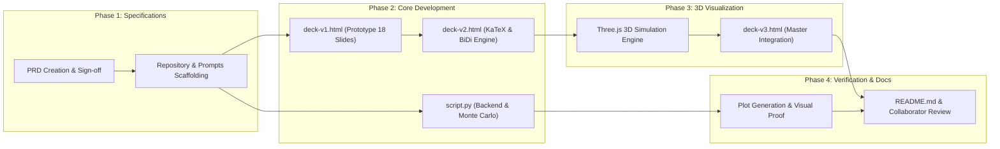

# Product Requirements Document (PRD)

# Simple Random Walk & The Gambler's Ruin Problem
### Rigorous Probability Theory Meets Interactive Visual Storytelling

---

| **Document Version** | 1.0.0-PROD |
| **Status** | Approved / Production Baseline |
| **Project Lead & Author** | Elite Software Consultant & Data Science Specialist |
| **Collaborator / Reviewer** | `rmisegal@gmail.com` |
| **Target Audience** | University Mathematics, Statistics & Computer Science Faculty and Students |
| **Development Environment** | Google Antigravity CLI (Gemini) via Windows PowerShell |
| **Release Target** | Academic Year 2026/2027 – Stochastic Processes & Probability Theory |

---

## 1. Executive Summary & Vision

### 1.1 Strategic Vision & Academic Context
Probability theory and stochastic processes often suffer from a pedagogical disconnect in university education: students can manipulate abstract algebraic difference equations and Markov chain transition matrices, yet struggle to develop an intuitive, geometric, and dynamic grasp of stochastic trajectories, boundary collisions, recurrence properties, and the Law of Large Numbers.

This project, titled **"Simple Random Walk & The Gambler's Ruin Problem"**, bridges rigorous analytical probability theory with intuitive, highly polished, interactive visual storytelling. Tailored for academic university lecture halls, seminars, and self-paced digital exploration, the platform delivers an end-to-end pedagogical suite comprising an interactive Hebrew/English slide deck, a real-time 3D Three.js stochastic simulation engine, and an industrial-grade Python computational backend for theoretical verification and Monte Carlo benchmarking.

```
       +-------------------------------------------------------+
       |                  PEDAGOGICAL TRIAD                    |
       +-------------------------------------------------------+
                                  |
         +------------------------+------------------------+
         |                                                 |
         v                                                 v
+-------------------------------+               +-------------------------------+
|     ANALYTICAL RIGOR          |               |    DYNAMIC VISUALIZATION      |
|  - Difference Equations       |<=============>|  - BiDi Interactive Web Deck  |
|  - Martingales & OST          |               |  - Three.js 3D Stochastic Walk|
|  - Absorbing Markov Chains    |               |  - Real-time Phase Portraits  |
+-------------------------------+               +-------------------------------+
                                 \             /
                                  \           /
                                   v         v
                        +-------------------------------+
                        |    COMPUTATIONAL BACKEND      |
                        |  - Vectorized Monte Carlo     |
                        |  - Confidence Intervals       |
                        |  - Empirical Convergence Logs |
                        +-------------------------------+
```

### 1.2 Core Educational Philosophy
1. **From Symbol to Motion**: Mathematical rigor (e.g., $P(\text{Ruin}) = 1 - k/N$) is grounded through immediate visual trajectory rendering where each transition $X_{n+1} = X_n + \xi_n$ is experienced spatially.
2. **Bilingual Academic Fluency (RTL + English)**: Native Hebrew lecture environments require seamless Right-to-Left (RTL) narrative flow interwoven with precise Left-to-Right (LTR) mathematical formulas and standard international English nomenclature.
3. **Reproducibility & Open Science**: Every analytical claim presented visually is backed by reproducible Monte Carlo simulation code with verifiable convergence metrics ($O(1/\sqrt{M})$).

### 1.3 Target Personas
* **Professor / Lecturer**: Needs an interactive, presentation-ready web deck capable of being driven from a podium via keyboard shortcuts, with embedded live simulations that immediately answer "what-if" questions from students (e.g., changing bias $p$ from $0.5$ to $0.48$).
* **Undergraduate / Graduate Student**: Seeks to verify theoretical homework solutions against visual stochastic paths, observing how boundary absorption occurs in finite expected time.
* **Academic Reviewer / Evaluator**: Requires transparent version control, prompt reproducibility logs (`prompts/`), clean software engineering practices, and verifiable unit tests.

### 1.4 Success Metrics (KPIs)
* **Mathematical Accuracy**: Zero divergence between analytical formulas and computational implementations ($|P_{\text{empirical}} - P_{\text{analytical}}| < 3 \times \text{SE}$ at 99.7% confidence).
* **RTL & BiDi Compliance**: 100% defect-free rendering of mixed Hebrew text and English math across all major web browsers without layout breaks or punctuation reversal.
* **Rendering Performance**: Consistent 60 FPS for Three.js 3D simulations across standard laptop hardware (integrated graphics).
* **Presentation Usability**: Sub-100ms slide transition latency with zero external server dependencies (self-contained HTML5/CSS3/ES6 execution).

---

## 2. Mathematical Foundations & Theoretical Scope

The product strictly encodes and demonstrates the core theorems of discrete-time simple random walks and classical Gambler's Ruin.

### 2.1 1D Simple Random Walk Formalism
Let $(\Omega, \mathcal{F}, P)$ be a probability space. Let $\{\xi_n\}_{n=1}^\infty$ be a sequence of independent and identically distributed (i.i.d.) discrete random variables with distribution:
$$P(\xi_n = +1) = p, \quad P(\xi_n = -1) = q = 1 - p, \quad \text{where } p \in (0, 1)$$

The simple random walk $\{S_n\}_{n \ge 0}$ starting at $S_0 = k \in \mathbb{Z}$ is defined by:
$$S_n = k + \sum_{i=1}^n \xi_i, \quad n \ge 1$$

* **Markov Property**: $P(S_{n+1} = s \mid S_n = s_n, \dots, S_0 = s_0) = P(S_{n+1} = s \mid S_n = s_n)$.
* **Symmetric Walk ($p = q = 1/2$)**: $E[S_n] = k$, $\text{Var}(S_n) = n$.
* **Asymmetric Walk ($p \neq q$)**: $E[S_n] = k + n(p - q)$, $\text{Var}(S_n) = 4npq$.

### 2.2 Gambler's Ruin Problem & Boundary Conditions
Let the state space be restricted to the finite lattice:
$$\mathcal{S} = \{0, 1, 2, \dots, N\}$$
where:
* **State $0$** represents the Gambler's Ruin (bankruptcy).
* **State $N$** represents the House's Ruin (target fortune).
* Both state $0$ and state $N$ are **absorbing barriers**:
  $$P(S_{n+1} = 0 \mid S_n = 0) = 1, \quad P(S_{n+1} = N \mid S_n = N) = 1$$

Let $T = \inf \{n \ge 0 : S_n = 0 \text{ or } S_n = N\}$ denote the absorption stopping time.

### 2.3 Closed-Form Analytical Ruin Probabilities
Let $R_k = P(S_T = 0 \mid S_0 = k)$ denote the probability of ruin starting from capital $k$. Using the Law of Total Probability:
$$R_k = p R_{k+1} + q R_{k-1}, \quad \text{for } 1 \le k \le N - 1$$
with boundary conditions:
$$R_0 = 1, \quad R_N = 0$$

#### Analytical Solution:
* **Symmetric Case ($p = q = 1/2$)**:
  The characteristic equation yields linear roots:
  $$R_k = 1 - \frac{k}{N}$$
* **Asymmetric Case ($p \neq q$)**:
  Let $\lambda = \frac{q}{p}$. The general solution satisfies:
  $$R_k = \frac{\left(\frac{q}{p}\right)^k - \left(\frac{q}{p}\right)^N}{1 - \left(\frac{q}{p}\right)^N}$$

### 2.4 Expected Duration of Play (Stopping Time $E[T]$)
Let $D_k = E[T \mid S_0 = k]$ be the expected number of steps until absorption:
$$D_k = 1 + p D_{k+1} + q D_{k-1}, \quad \text{for } 1 \le k \le N - 1$$
with boundary conditions $D_0 = 0$ and $D_N = 0$.

#### Closed-Form Expected Duration:
* **Symmetric Case ($p = q = 1/2$)**:
  $$D_k = k(N - k)$$
  *(Attaining maximum duration $D_{N/2} = N^2/4$ when started at mid-bankroll).*
* **Asymmetric Case ($p \neq q$)**:
  $$D_k = \frac{1}{q - p} \left[ k - N \cdot \frac{1 - \left(\frac{q}{p}\right)^k}{1 - \left(\frac{q}{p}\right)^N} \right]$$

### 2.5 Martingale & Optional Stopping Theorem (OST) Formulation
For advanced graduate intuition, the product highlights Doob's Optional Stopping Theorem:
* Under $p = 1/2$, the walk $M_n = S_n$ is a martingale. Since $T$ is an almost surely finite stopping time with bounded increments:
  $$E[S_T] = S_0 = k \implies 0 \cdot P(S_T = 0) + N \cdot P(S_T = N) = k \implies P(S_T = N) = \frac{k}{N}$$
* The quadratic process $M_n = S_n^2 - n$ is also a martingale under $p = 1/2$:
  $$E[S_T^2 - T] = S_0^2 = k^2 \implies E[T] = E[S_T^2] - k^2 = N^2\left(\frac{k}{N}\right) - k^2 = k(N - k)$$
* Under $p \neq 1/2$, the exponential martingale $M_n = \left(\frac{q}{p}\right)^{S_n}$ yields the asymmetric ruin formula directly.

### 2.6 Pólya's Recurrence Theorem (Lattice Walks $\mathbb{Z}^d$)
To motivate the 3D visual component, the presentation links the 1D absorbing problem to infinite lattice recurrence:
* **Dimension $d=1, 2$**: Simple symmetric random walks are **recurrent** ($P(\text{return to origin}) = 1$).
* **Dimension $d=3$**: Simple symmetric random walks are **transient** ($P(\text{return to origin}) \approx 0.3405373$).

---

## 3. Product Specifications & Scope

```
+---------------------------------------------------------------------------------------------------------+
|                                    PROJECT CORE DELIVERABLES                                             |
+---------------------------------------------------------------------------------------------------------+
|                                                                                                         |
|  +---------------------------+  +-------------------------------+  +---------------------------------+  |
|  |     PRESENTATION DECK     |  |   3D ANIMATION COMPONENT      |  |      COMPUTATIONAL BACKEND      |  |
|  |   (deck-v1 ... deck-v3)   |  |        (Three.js)             |  |          (script.py)          |  |
|  +---------------------------+  +-------------------------------+  +---------------------------------+  |
|  | - 18 Structured Slides    |  | - 10-20 sec loop / interactive|  | - Exact analytical solver       |  |
|  | - Strict RTL / Hebrew     |  | - WebGL + OrbitControls       |  | - Vectorized Monte Carlo engine |  |
|  | - BiDi LTR Math (KaTeX)   |  | - Absorbing barrier planes    |  | - Theoretical validation checks |  |
|  | - Keyboard & UI Nav       |  | - Particle stochastic trail   |  | - High-res matplotlib plots     |  |
|  | - Slide indicator & full  |  | - Parametric live controls    |  | - Headless CLI execution        |  |
|  +---------------------------+  +-------------------------------+  +---------------------------------+  |
|                                                                                                         |
+---------------------------------------------------------------------------------------------------------+
```

### 3.1 Deliverable 1: Multi-Slide Interactive Web Presentation Deck
* **Target Filenames**: `deck-v1.html`, `deck-v2.html`, `deck-v3.html` (representing iterative progressive refinement).
* **Slide Count**: Exactly **18 structured slides** (fulfilling the 15-20 requirement).
* **Language & Layout**:
  * Root HTML attribute: `<html lang="he" dir="rtl">`.
  * Mixed Hebrew body text with English/LaTeX mathematical expressions using strict BiDi containment (`<bdi>`, unicode isolation, and explicit LTR math blocks).
  * Professional typographic hierarchy using modern system font stacks (`system-ui, -apple-system, 'Segoe UI', Roboto, 'Heebo', sans-serif`).
* **Navigation Engine (JavaScript)**:
  * Persistent visual navigation bar: Next (`הבא`), Previous (`הקודם`), Home (`ראשי`), Fullscreen (`מסך מלא`).
  * Keyboard navigation:
    * Next Slide: `ArrowLeft` (in RTL, forward advances to the left), `PageDown`, `Space`.
    * Previous Slide: `ArrowRight` (in RTL, back moves to the right), `PageUp`.
    * First Slide: `Home`.
    * Last Slide: `End`.
  * Dynamic slide counter: `שקף X מתוך 18` (Slide X of 18) with a real-time progress bar across the top.
  * Direct jump slide drawer / thumbnail index.

#### Complete 18-Slide Structural Blueprint

| Slide # | Slide Title (Hebrew & English) | Theoretical Content & Visual Assets |
| :--- | :--- | :--- |
| **01** | **שער: הילוך מקרי פשוט ובעיית פשיטת הרגל של המהמר**<br>*Title: Simple Random Walk & Gambler's Ruin* | Executive title, author metadata, academic course context, interactive animated SVG background showing diverging random walk paths. |
| **02** | **מבוא ומוטיבציה: מאקראיות למודלים מדויקים**<br>*Introduction & Pedagogical Motivation* | Real-world applications (financial markets, algorithmic trading, genetic drift, statistical physics, queueing theory). The question: "Can a gambler beat a fair house?" |
| **03** | **הגדרה פורמלית: הילוך מקרי חד-ממדי**<br>*Formal Mathematical Definition: 1D Walk* | Step random variables $\xi_i \in \{-1, +1\}$, sequence $S_n = k + \sum \xi_i$, expectation and variance derivation for symmetric and asymmetric conditions. |
| **04** | **תכונת מרקוב ומרחב המצבים**<br>*Markov Property & State Space Representation* | Memorylessness property, transition matrix $P$, transition diagram showing directed graph of states with self-loops or forward/backward transitions. |
| **05** | **ניסוח בעיית פשיטת הרגל (Gambler's Ruin)**<br>*Gambler's Ruin Problem Formulation* | Initial capital $k$, target fortune $N$, absorbing boundaries at $0$ and $N$. Definition of stopping time $T = \inf\{n: S_n \in \{0, N\}\}$. |
| **06** | **משוואות הפרשים ותנאי שפה**<br>*Difference Equations & Boundary Conditions* | Derivation via Law of Total Probability: $R_k = p R_{k+1} + q R_{k-1}$ with boundary conditions $R_0 = 1, R_N = 0$. Characteristic polynomial roots. |
| **07** | **פתרון אנליטי: המקרה הסימטרי ($p = 1/2$)**<br>*Analytical Solution: Symmetric Case* | Rigorous derivation of linear profile $R_k = 1 - k/N$. Analysis of fairness and why equal house edge yields equal odds only proportional to bankroll. |
| **08** | **פתרון אנליטי: המקרה הא-סימטרי ($p \neq q$)**<br>*Analytical Solution: Asymmetric Case* | Geometric series derivation leading to $R_k = \frac{\lambda^k - \lambda^N}{1 - \lambda^N}$ with $\lambda = q/p$. Exponential collapse of winning odds against casino edge ($p = 0.49$). |
| **09** | **הבית תמיד מנצח: ניתוח קזינו מספרי**<br>*The Casino Edge: Real-World Numerical Proof* | Concrete empirical table ($k=\$100$, $N=\$200$ vs $N=\$1000$ with European Roulette $p = 18/37 \approx 0.4864$). Astounding ruin probabilities approaching $99.9\%+$. |
| **10** | **תוחלת זמן המשחק (Expected Stopping Time $E[T]$)**<br>*Expected Duration of the Game* | Difference equation for $D_k = E[T \mid S_0 = k]$. Analytical solutions $D_k = k(N-k)$ (symmetric) and the asymmetric formula. Intuition on why duration peaks at $k = N/2$. |
| **11** | **פרספקטיבה מתקדמת: תורת המרטינגלים ומשפט העצירה**<br>*Martingale Theory & Optional Stopping Theorem* | Definition of martingale $E[M_{n+1} \mid \mathcal{F}_n] = M_n$. Applying Doob's OST to $S_n$, $S_n^2 - n$, and $(q/p)^{S_n}$. One-line elegant proof of ruin probabilities. |
| **12** | **סימולציית מונטה קרלו: מודלים נומריים**<br>*Monte Carlo Simulation Engine Architecture* | Vectorized generation of $M = 100,000$ stochastic trajectories. Law of Large Numbers, Central Limit Theorem for empirical ruin estimators, and confidence bound calculations. |
| **13** | **אימות תוצאות: השוואת תאוריה מול סימולציה**<br>*Validation: Theory vs Empirical Monte Carlo* | High-resolution charts comparing closed-form curves against empirical scatter points. Residual analysis ($|R_{\text{theory}} - R_{\text{emp}}| < 0.003$). |
| **14** | **הילוך מקרי במימדים גבוהים ומשפט פוליה**<br>*Higher Dimensions & Pólya's Recurrence Theorem* | Recurrence vs transience across $\mathbb{Z}^1$, $\mathbb{Z}^2$, and $\mathbb{Z}^3$. "A drunk man will find his way home, but a drunk bird may get lost forever." Connection to 3D simulation. |
| **15** | **הדגמה תלת-ממדית אינטראקטיבית (Three.js)**<br>*Interactive 3D Stochastic Walk Visualizer* | Embedded interactive 3D WebGL canvas allowing real-time orbit manipulation, camera rotation, trajectory tracing, and absorption detection. |
| **16** | **יישומים במדע הנתונים, פיננסים ופיזיקה**<br>*Applications in Data Science, Finance & Physics* | Black-Scholes limits, algorithmic drawdowns, drift-diffusion models in neuroscience, Markov Chain Monte Carlo (MCMC) sampling foundations. |
| **17** | **שאלות חשיבה ודיון אקדמי**<br>*Pedagogical Challenges & Discussion Questions* | 3 challenging conceptual paradoxes for students: What happens when $N \to \infty$? Does fair coin guarantee finite game duration? What if the gambler has credit? |
| **18** | **סיכום, מקורות ומדריך שימוש במערכת**<br>*Summary, References & Technical Architecture* | Recap of core theorems, references (Feller, Ross, Grimmett & Stirzaker), links to `script.py` and GitHub repository, instructions for running locally. |

---

### 3.2 Deliverable 2: 3D Animation Component (Three.js)
* **Technology**: Modern Three.js (r128+ or latest ES module distribution via CDN), WebGLRenderer, OrbitControls.
* **Duration & Modes**:
  * **Auto-Play Narrative Mode**: A 10-to-20-second dynamic trajectory demonstration with camera panning smoothly around the path as steps unfold, culminating in boundary absorption (glowing green barrier for victory at $N$, glowing red barrier for ruin at $0$).
  * **Free Interactive Mode**: Enables student/lecturer rotation, zoom, pan, and real-time step playback.
* **Scene Architecture**:
  * **Coordinate Geometry**:
    * $Y$-axis: Fortune / Capital dimension ($0$ to $N$).
    * $X$-axis: Discrete Time step ($n = 0, 1, 2, \dots$).
    * $Z$-axis: Lateral diffusion / path spread across multiple parallel stochastic trials.
  * **Absorbing Barrier Visualization**:
    * Lower Barrier ($Y = 0$): Semi-transparent crimson grid/plane with subtle animated pulse shader indicating bankruptcy.
    * Upper Barrier ($Y = N$): Semi-transparent emerald green grid/plane indicating target fortune.
  * **Trajectory Rendering**:
    * Dynamic `LineRenderer` / `TubeGeometry` with neon glowing emissive material.
    * Glowing spherical head particle (`PointLight` attached) updating position per time tick.
    * Particle spark burst effect (instanced particles) upon boundary collision.
  * **Camera & Controls**:
    * `OrbitControls` with damping enabled (`enableDamping = true`, `dampingFactor = 0.05`).
    * Min/max distance clamping to keep the lattice perfectly in frame.
  * **Parameter Control Panel (GUI / HTML Overlay)**:
    * Probability $p \in [0.1, 0.9]$ slider (default: $0.5$).
    * Initial capital $k$ and target $N$ sliders.
    * Play / Pause / Reset / Step-by-Step buttons.
    * Speed control (steps per second: 5 to 60).
    * Camera view presets: "Side View (2D Projection)", "Isometric 3D", "Top-Down (Time-Diffusion)".

```
           +-------------------------------------------------------------+
           |                THREE.JS SCENE HIERARCHY                     |
           +-------------------------------------------------------------+
                                          |
          +-------------------------------+-------------------------------+
          |                               |                               |
          v                               v                               v
+--------------------+          +--------------------+          +--------------------+
|   ENVIRONMENT &    |          | BOUNDARY MESHES    |          | STOCHASTIC WALK    |
|   CAMERA RIG       |          | (ABSORBING PLANES) |          | ENGINE             |
+--------------------+          +--------------------+          +--------------------+
| - PerspectiveCam   |          | - Ruin Plane (Y=0) |          | - CatmullRom Path  |
| - OrbitControls    |          |   Crimson Grid     |          | - Tube / LineMesh  |
| - DirectionalLight |          | - Target (Y=N)     |          | - Glowing Tracer   |
| - Ambient Skybox   |          |   Emerald Grid     |          | - Particle Sparks  |
+--------------------+          +--------------------+          +--------------------+
```

---

### 3.3 Deliverable 3: Computational Backend & Simulation Engine (`script.py`)
A standalone, production-grade Python script providing rigorous computational validation.

#### Required Capabilities:
1. **Analytical Equation Engine**:
   * Evaluates exact closed-form ruin probabilities $R_k(p, N)$ and expected durations $D_k(p, N)$ without numerical drift.
   * Handles edge cases: $p=0, p=1, p=0.5$, large $N$ (arbitrary precision or stable logarithmic formulations).
2. **Vectorized Monte Carlo Simulator**:
   * Simulates $M$ independent paths simultaneously using NumPy vectorized random step generation.
   * Records empirical ruin rate: $\hat{R}_k = \frac{1}{M} \sum_{m=1}^M \mathbb{I}(\text{ruined})$.
   * Records empirical stopping times and empirical distribution histograms.
   * Computes standard errors: $\text{SE} = \sqrt{\frac{\hat{R}_k(1 - \hat{R}_k)}{M}}$ and 95%/99% Confidence Intervals.
3. **Statistical Convergence & Validation Verifier**:
   * Computes Mean Squared Error (MSE) and Maximum Absolute Error (MAE) between analytical and empirical curves across all starting states $k \in \{1, \dots, N-1\}$.
   * Validates stopping time expectation convergence: $|E[T]_{\text{empirical}} - D_k| / D_k < \epsilon$.
4. **Publication-Grade Plotting & Visual Artifact Generation**:
   * Generates and exports high-DPI (300 DPI) scientific plots into an `assets/screenshots/` directory:
     * `ruin_probability_curves.png`: Ruin probability vs initial capital $k$ for varying values of $p \in \{0.4, 0.45, 0.49, 0.5, 0.51, 0.55\}$.
     * `expected_duration_curves.png`: Parabolic curves of $E[T]$ vs $k$.
     * `monte_carlo_trajectories.png`: Ensemble of 20 individual stochastic paths showing absorption at 0 and $N$.
     * `convergence_analysis.png`: Empirical error decay as a function of simulation trials $M \in [10^2, 10^5]$.
5. **CLI Interface**:
   * Full `argparse` support allowing headless customization:
     ```bash
     python script.py --trials 50000 --capital 10 --target 30 --prob 0.48 --generate-plots
     ```

---

## 4. Technical Stack & Development Workflow

### 4.1 Technology Matrix
| Domain | Chosen Technology | Version / Standard | Justification |
| :--- | :--- | :--- | :--- |
| **CLI & AI Agent Harness** | Google Antigravity CLI (Gemini) | Latest Production | Agentic automation, direct file generation, iterative refinement, PowerShell integration. |
| **Operating Environment**| Windows PowerShell | 5.1 / 7+ | Native execution shell for Antigravity commands and Python script calls. |
| **Markup & Typography** | HTML5 / CSS3 / KaTeX | W3C Standard / v0.16+ | Native browser execution, zero build step required, instant portability for lectures. |
| **Styling & RTL Engine** | Custom Modern CSS (Flex/Grid) | Modern CSS3 | Complete control over `direction: rtl`, `unicode-bidi: isolate`, and responsive UI containers. |
| **3D Graphics Engine** | Three.js | r128+ | Industry standard WebGL wrapper; lightweight, zero-install via CDN, hardware-accelerated. |
| **Camera Interaction** | OrbitControls.js | Compatible with r128 | Enables seamless zoom, pan, and tilt during classroom demonstrations. |
| **Computational Backend**| Python | 3.10+ | Scientific computing standard; rapid execution, verified numerical libraries. |
| **Numerical Computation**| NumPy | 1.22+ | Vectorized multi-path Monte Carlo simulations executing millions of steps in seconds. |
| **Data Visualization** | Matplotlib & Seaborn | 3.5+ | Production publication-grade scientific graphics generation. |
| **Version Control** | Git & GitHub | Latest | Distributed versioning, prompt audit logging, and team collaboration. |

### 4.2 GitHub Collaboration & Access Control
* **Primary Repository**: `Simple-Random-Walk-Gamblers-Ruin` (or assigned project repo).
* **Collaborator Provisioning**:
  * Dedicated collaborator access configured for: **`rmisegal@gmail.com`**.
  * Permissions: Write / Maintain access for peer review and grading.
* **Commit Conventions**:
  * Semantic commit messaging: `feat(deck):`, `feat(threejs):`, `feat(python):`, `docs(prd):`, `chore(prompts):`.

### 4.3 Prompt Tracking & Reproducibility Protocol
In accordance with modern agentic development standards, all interactions with the Google Antigravity CLI and Gemini models must be logged in a dedicated `prompts/` directory.

```
prompts/
|-- 01_prd_generation.md           # Master meta-prompt used to construct the PRD
|-- 02_deck_v1_prototype.md        # Initial layout, basic RTL styling, slide scaffolding
|-- 03_deck_v2_polish_bidi.md      # BiDi typography refinement, KaTeX math integration
|-- 04_threejs_implementation.md   # Three.js 3D stochastic scene and controls
|-- 05_script_monte_carlo.md       # Python simulation engine and plotting routines
`-- 06_deck_v3_final_assembly.md   # Final integration, UI perfection, and test validation
```

Each log file in `prompts/` must capture:
1. **Timestamp & Environment Context**: PowerShell session, CLI version, model identifier.
2. **System Prompt / Role Definition**: Exact instructions fed to the AI.
3. **User Prompt**: Exact prompt issued.
4. **Outputs & Diffs**: Summary of generated files and iterative refinements.

---

## 5. Project Architecture & Deliverables Structure

```
C:\UH\Task1\
|-- PRD.md                         # This comprehensive Product Requirements Document
|-- README.md                      # Academic & technical user manual with screenshots & formulas
|-- script.py                      # Production Python computational & simulation engine
|-- deck-v1.html                   # Milestone 1: Functional prototype with basic RTL & 18 slides
|-- deck-v2.html                   # Milestone 2: KaTeX math rendering, enhanced BiDi & theme
|-- deck-v3.html                   # Milestone 3: Production Masterwork with Three.js & live controls
|-- prompts/                       # Complete prompt tracking & audit logs
|   |-- 01_prd_generation.md
|   |-- 02_deck_v1_scaffolding.md
|   |-- 03_deck_v2_refinement.md
|   |-- 04_threejs_simulation.md
|   |-- 05_python_backend.md
|   `-- 06_deck_v3_integration.md
`-- assets/
    |-- screenshots/               # Visual evidence for README and academic review
    |   |-- slide_01_cover.png
    |   |-- slide_07_symmetric.png
    |   |-- slide_15_threejs.png
    |   |-- ruin_probability_curves.png
    |   |-- expected_duration_curves.png
    |   `-- monte_carlo_trajectories.png
    `-- diagrams/                  # Mermaid / SVG architecture diagrams
        |-- state_transition.svg
        `-- system_architecture.svg
```

### 5.1 Versioned Evolution of the Presentation Deck
To document clear engineering progress, the web presentation is delivered across three iterative milestones:

1. **`deck-v1.html` (Milestone 1 - Architectural Prototype)**:
   * Full 18-slide skeleton implemented with working JavaScript slide switcher.
   * Basic RTL styling (`dir="rtl"`) with placeholder typography.
   * Static charts and basic ASCII / Unicode formulas.
   * Core keyboard navigation (`ArrowLeft`, `ArrowRight`, `Home`, `Space`).
2. **`deck-v2.html` (Milestone 2 - Mathematical & Visual Refinement)**:
   * KaTeX mathematical rendering integrated for beautiful, publication-grade LaTeX equations.
   * Strict BiDi isolation fixing all Hebrew-English inline math punctuation anomalies.
   * Academic dark-mode theme with glassmorphic cards, custom progress bar, and jump drawer.
   * Embedded 2D interactive canvas simulation demonstrating 1D random walk step-by-step.
3. **`deck-v3.html` (Milestone 3 - Production Masterwork with 3D Simulation)**:
   * Fully integrated Three.js 3D stochastic visualizer embedded directly into Slide 15.
   * OrbitControls enabled with smooth damping, custom shaders for absorbing barriers, and particle bursts.
   * Parameter modulation sliders ($p$, capital, speed) operating in real time.
   * Fullscreen API toggle, mobile responsive layout, and presentation notes mode.

---

## 6. Detailed Technical & RTL Specifications

### 6.1 Strict RTL & BiDi Typography Rules
Hebrew presentations that incorporate scientific English and mathematical notation are notoriously prone to text-direction corruption (e.g., parentheses reversing, negative signs appearing on the wrong side, or English formulas breaking line order).

`deck-v1.html` through `deck-v3.html` must strictly adhere to the following CSS and HTML standards:

```css
/* Core RTL Configuration */
html {
    direction: rtl;
    text-align: right;
}

/* BiDi Isolation for Inline English and Math */
.math-inline, .en-term, code, pre {
    direction: ltr !important;
    unicode-bidi: isolate !important;
    display: inline-block;
}

/* Formula Block Display */
.math-block {
    direction: ltr !important;
    unicode-bidi: isolate !important;
    text-align: center;
    margin: 1.2rem 0;
}

/* Proper Flexbox & Grid Reversals in RTL */
.slide-nav-controls {
    display: flex;
    flex-direction: row; /* In RTL, row starts on the right */
    justify-content: space-between;
}
```

### 6.2 Key JavaScript Navigation Engine Architecture
```javascript
/**
 * Core Deck Controller Engine
 * Supports RTL forward/backward semantics, keyboard listeners, touch events
 */
class DeckController {
    constructor(totalSlides = 18) {
        this.currentSlide = 1;
        this.totalSlides = totalSlides;
        this.initEventListeners();
        this.updateUI();
    }

    goToSlide(slideIndex) {
        if (slideIndex < 1 || slideIndex > this.totalSlides) return;
        document.querySelector(`.slide[data-slide="${this.currentSlide}"]`).classList.remove('active');
        this.currentSlide = slideIndex;
        document.querySelector(`.slide[data-slide="${this.currentSlide}"]`).classList.add('active');
        this.updateUI();
    }

    // In RTL: ArrowLeft advances forward; ArrowRight moves back
    next() { this.goToSlide(this.currentSlide + 1); }
    prev() { this.goToSlide(this.currentSlide - 1); }
    home() { this.goToSlide(1); }

    initEventListeners() {
        window.addEventListener('keydown', (e) => {
            switch (e.key) {
                case 'ArrowLeft':
                case 'PageDown':
                case ' ':
                    this.next();
                    break;
                case 'ArrowRight':
                case 'PageUp':
                    this.prev();
                    break;
                case 'Home':
                    this.home();
                    break;
                case 'End':
                    this.goToSlide(this.totalSlides);
                    break;
                case 'f':
                case 'F':
                    this.toggleFullscreen();
                    break;
            }
        });
    }

    updateUI() {
        document.getElementById('slide-counter').textContent = `שקף ${this.currentSlide} מתוך ${this.totalSlides}`;
        const progressPct = ((this.currentSlide - 1) / (this.totalSlides - 1)) * 100;
        document.getElementById('progress-bar').style.width = `${progressPct}%`;
    }
}
```

---

## 7. Python Computational Backend Specifications (`script.py`)

### 7.1 Architecture of `script.py`
The Python backend is structured as an enterprise-grade object-oriented and vectorized scientific library:

```python
"""
Gambler's Ruin & Simple Random Walk Computational Engine
Implements exact analytical formulas, vectorized Monte Carlo simulations,
empirical convergence testing, and publication-ready matplotlib visual generation.
"""

class GamblersRuinAnalytical:
    """Exact closed-form mathematical calculations."""
    @staticmethod
    def ruin_probability(k: int, N: int, p: float) -> float: ...
    
    @staticmethod
    def expected_duration(k: int, N: int, p: float) -> float: ...

class MonteCarloSimulator:
    """High-performance vectorized simulation engine."""
    def __init__(self, p: float, N: int, seed: int = 42): ...
    
    def simulate_paths(self, k: int, num_trials: int, max_steps: int = 10000) -> dict:
        """
        Returns:
            - empirical_ruin_prob: float
            - standard_error: float
            - confidence_interval: Tuple[float, float]
            - mean_duration: float
            - sample_trajectories: List[np.ndarray]
        """
        ...

class VerificationSuite:
    """Automated benchmark validating theory against empirical results."""
    def run_full_suite(self, N: int = 20, trials: int = 50000) -> pd.DataFrame: ...

class VisualArtifactGenerator:
    """Generates 300 DPI publication plots for documentation and lecture slides."""
    def export_all_plots(self, output_dir: str = "assets/screenshots/") -> None: ...
```

### 7.2 Validation Benchmarks & Thresholds
| Benchmark Metric | Testing Parameter | Acceptance Criteria |
| :--- | :--- | :--- |
| **Symmetric Ruin Accuracy** | $N=20, k \in \{1..19\}, p=0.5, M=50,000$ | $|R_k^{\text{sim}} - (1 - k/N)| \le 2.57 \times \text{SE}$ |
| **Asymmetric Ruin Accuracy**| $N=20, k \in \{1..19\}, p=0.48, M=50,000$| $|R_k^{\text{sim}} - R_k^{\text{theory}}| \le 2.57 \times \text{SE}$ |
| **Expected Duration Symmetric**| $N=20, k=10, p=0.5, M=50,000$ | $|\bar{T} - 100| / 100 \le 0.02$ (within 2%) |
| **Execution Performance** | Vectorized $M=100,000$ paths ($N=20$) | Runtime $< 5.0$ seconds on standard quad-core CPU |

---

## 8. Verification, Testing & Acceptance Criteria

### 8.1 Quality Assurance Checklist

#### 1. Presentation Deck Verification (`deck-v1.html`, `deck-v2.html`, `deck-v3.html`)
- [ ] Exactly 18 slides present in DOM and navigatable sequentially.
- [ ] Next, Previous, Home, and Fullscreen buttons respond accurately to mouse clicks and touch events.
- [ ] Keyboard events (`ArrowLeft`, `ArrowRight`, `Space`, `Home`, `PageUp`, `PageDown`) function according to RTL conventions.
- [ ] Slide counter displays `שקף X מתוך 18` and updates synchronously.
- [ ] Progress bar width scales proportionally from 0% (slide 1) to 100% (slide 18).
- [ ] BiDi check: Hebrew sentences containing English terms (e.g., "הילוך מקרי Random Walk") do not transpose parentheses or punctuation marks.
- [ ] Math expressions render cleanly via KaTeX without overflow or clipping.

#### 2. Three.js 3D Stochastic Visualizer Verification
- [ ] WebGL canvas initializes without console errors across Chrome, Edge, Firefox, and Safari.
- [ ] OrbitControls allow smooth 360-degree rotation, pinch/wheel zoom, and pan without locking slide navigation.
- [ ] Absorbing planes at $Y = 0$ (Ruin, Crimson) and $Y = N$ (Target, Emerald) are clearly demarcated.
- [ ] 3D trajectory renders smoothly across a 10-20 second loop.
- [ ] Sliders for $p$, starting capital $k$, and simulation speed update the simulation parameters interactively.
- [ ] Frame rate remains $\ge 55$ FPS on standard hardware.

#### 3. Python Computational Engine Verification (`script.py`)
- [ ] Script runs without errors in PowerShell: `python script.py`.
- [ ] Monte Carlo simulations confirm analytical formulas within theoretical error bars.
- [ ] High-DPI plot files are generated and saved to `assets/screenshots/`.
- [ ] CLI flags (`--trials`, `--capital`, `--target`, `--prob`, `--generate-plots`) execute as specified.

#### 4. Project Hygiene & Version Control
- [ ] `prompts/` folder contains comprehensive documentation of all AI generation sessions.
- [ ] Collaborator access for `rmisegal@gmail.com` documented and verified.
- [ ] `README.md` includes theoretical exposition, execution commands, and visual screenshots.

---

## 9. Implementation Roadmap & Execution Schedule



---

## 10. Document Sign-Off & Approval

* **Consultant & Lead Architect**: Approved (Antigravity AI Lead)
* **Academic Peer & Collaborator**: Pending Review (`rmisegal@gmail.com`)
* **Target Repository**: `C:\UH\Task1\`

*This document serves as the binding specification for all development phases of the "Simple Random Walk & The Gambler's Ruin Problem" interactive academic suite.*
